


 

  

 

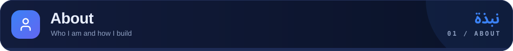

 

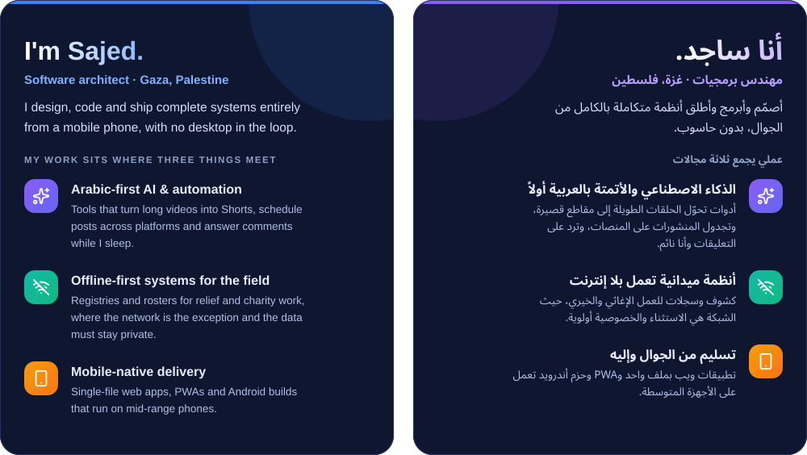

  

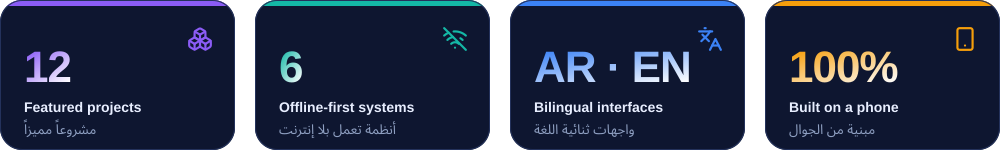

  

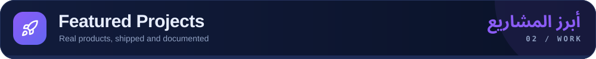

  

 

<a href="https://github.com/Dev-saged/Lakta-Studio-AI">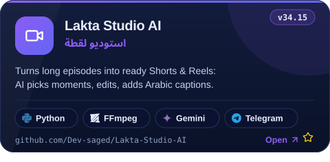</a>
<a href="https://github.com/Dev-saged/sawan-kids-story-studio">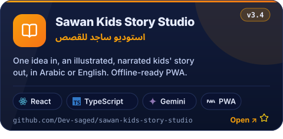</a>
<a href="https://github.com/Dev-saged/social-manager">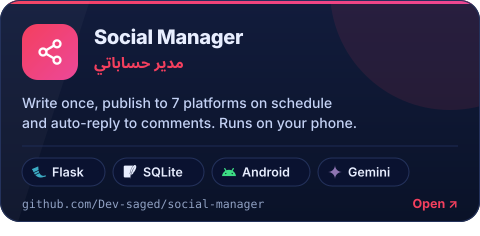</a>
<a href="https://github.com/Dev-saged/bulldozer-social">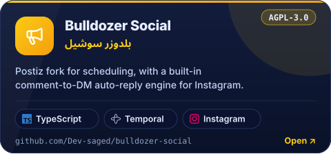</a>
<a href="https://github.com/Dev-saged/release-manager-pro">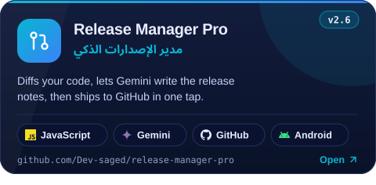</a>
<a href="https://github.com/Dev-saged/local-sms-parser">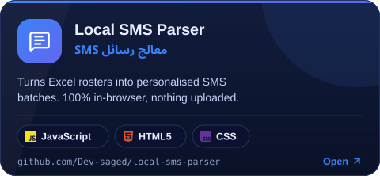</a>

 

 

<a href="https://github.com/Dev-saged/wasla-system">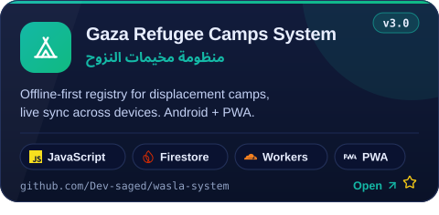</a>
<a href="https://github.com/Dev-saged/ghiras-alkhair">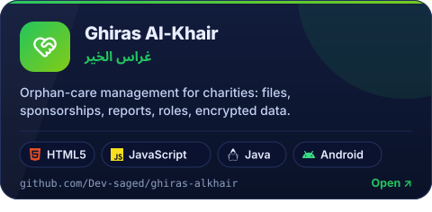</a>
<a href="https://github.com/Dev-saged/Mushajjir">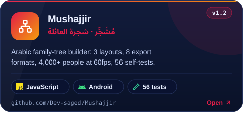</a>
<a href="https://github.com/Dev-saged/offline-aid-manager">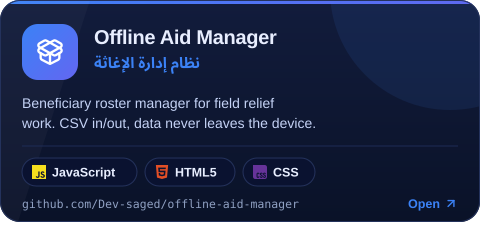</a>
<a href="https://github.com/Dev-saged/Anabat">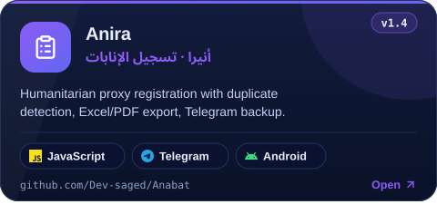</a>
<a href="https://github.com/Dev-saged/daftar">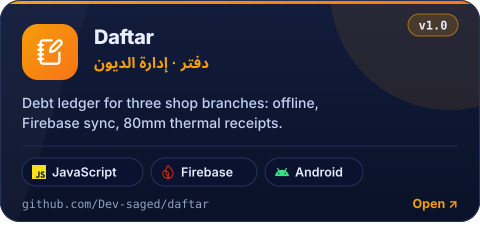</a>

 

 

 

<a href="https://github.com/Dev-saged/Vyce-Ai">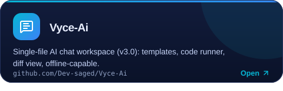</a>
<a href="https://github.com/Dev-saged/aneera">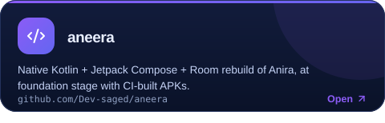</a>
<a href="https://github.com/Dev-saged/bakery-pos">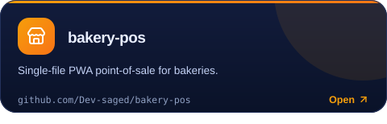</a>
<a href="https://github.com/Dev-saged/Dukanak-Bot">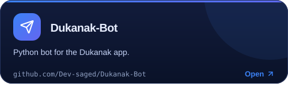</a>
<a href="https://github.com/Dev-saged/NetSubsManager">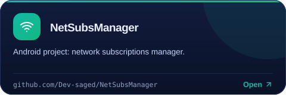</a>

 

 

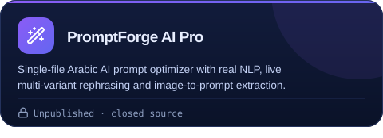
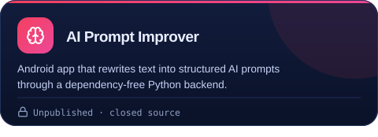
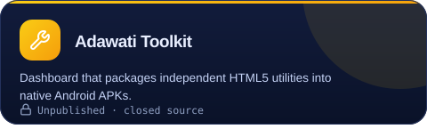
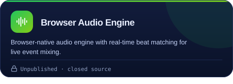

 

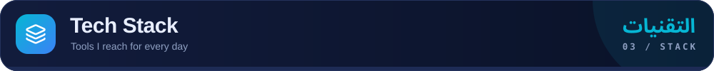

  

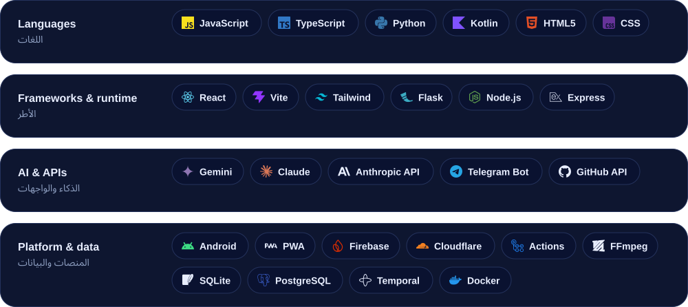

  

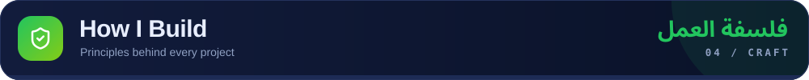

  

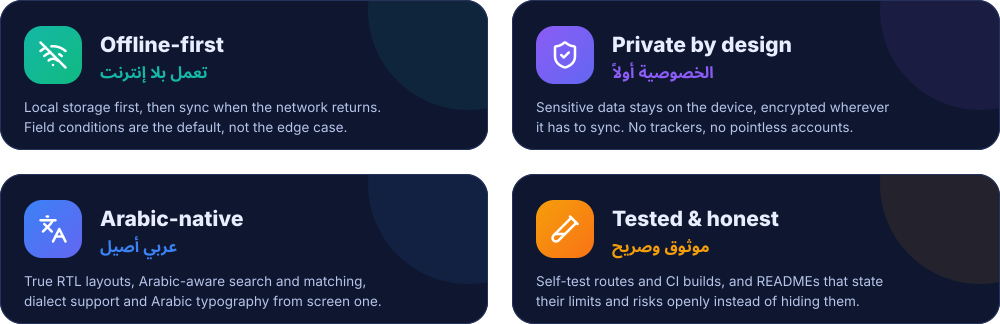

  

  

  

 

 

 

